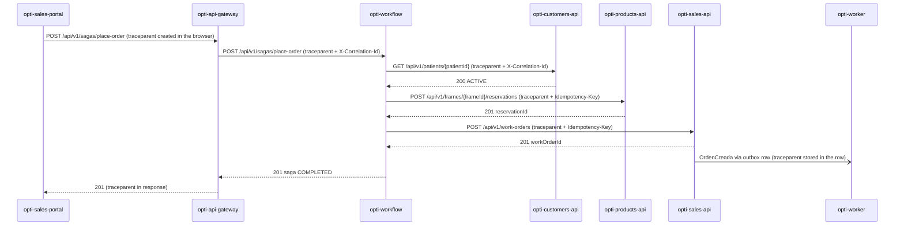

# CP1 · Critical journey and trace map

## Journey: Place order (seller registers a sale for a patient)

A seller in `opti-sales-portal` sells a frame to a patient. The request goes through
`opti-api-gateway` (nginx) to `opti-workflow`, which runs the **place-order saga**
(ADR-004) with three steps: `check-patient`, `reserve-stock` and `open-order`.

Why this journey: it is the one that makes money for the optical store, it crosses
five components, and if it fails halfway it leaves a frame reserved with no work order
(the compensation case of ADR-004).

Sources in `opti-docs`: `05-architecture/overview.md` (service ↔ repository mapping),
`05-architecture/decisions/records/ADR-004-place-order-saga.md`,
`05-architecture/decisions/records/ADR-005-outbox-eventual-consistency.md`,
`02-domain/domain-events.md` (`OrdenCreada`).

## Hop table

| Step | Caller | Callee | Protocol | Operation | Sync/Async | Data |
|---|---|---|---|---|---|---|
| 1 | opti-sales-portal (browser) | opti-api-gateway | REST | `POST /api/v1/sagas/place-order` | sync | none |
| 2 | opti-api-gateway | opti-workflow | REST | `POST /api/v1/sagas/place-order` (`Idempotency-Key`) | sync | Redis (saga state) |
| 3 | opti-workflow | opti-customers-api | REST | `GET /api/v1/patients/{patientId}` (step `check-patient`) | sync | `customers` DB (`patient`) |
| 4 | opti-workflow | opti-products-api | REST | `POST /api/v1/frames/{frameId}/reservations` (step `reserve-stock`) | sync | `products.stock_reservation`, `products.frame` |
| 5 | opti-workflow | opti-sales-api | REST | `POST /api/v1/work-orders` (step `open-order`) | sync | `sales.work_order`, `sales.work_order_item` |
| 6 | opti-sales-api | outbox → opti-worker | outbox row + poll (ADR-005, target) | `OrdenCreada` / sales goal check | async | `sales` outbox (planned) |

Notes:
- Today `opti-api-gateway` already sends `X-Correlation-Id` to the service
  (`nginx/snippets/proxy.conf`) and every `-api` has a `CorrelationFilter`. What is
  missing is the W3C `traceparent` header, so this map adds it next to the
  correlation id, it does not replace it.
- Step 6 is the async boundary. There is no broker yet (`domain-events.md` says
  "RabbitMQ/Kafka, not finalized"), so the trace context is saved in the outbox row
  (`traceparent` column) and `opti-worker` restores it when it processes the row.
- If step 5 fails, `opti-workflow` calls the compensation
  `POST /api/v1/reservations/{reservationId}/release` on `opti-products-api`. That call
  is a child span of the same trace.

## Sequence diagram with trace context

## Span tree

All spans share the same `trace_id`. Indentation = parent → child.

- `POST /api/v1/sagas/place-order` — root, `opti-api-gateway` (kind SERVER)
  - `saga place-order` — `opti-workflow` (SERVER)
    - `step check-patient` — `opti-workflow` (INTERNAL)
      - `GET /api/v1/patients/{patientId}` — client span in `opti-workflow` (CLIENT)
        - `GET /api/v1/patients/{patientId}` — `opti-customers-api` (SERVER)
          - `SELECT customers.patient` — (CLIENT, DB)
    - `step reserve-stock` — `opti-workflow` (INTERNAL)
      - `POST /api/v1/frames/{frameId}/reservations` — client span (CLIENT)
        - `POST /api/v1/frames/{frameId}/reservations` — `opti-products-api` (SERVER)
          - `INSERT products.stock_reservation` — (CLIENT, DB)
    - `step open-order` — `opti-workflow` (INTERNAL)
      - `POST /api/v1/work-orders` — client span (CLIENT)
        - `POST /api/v1/work-orders` — `opti-sales-api` (SERVER)
          - `INSERT sales.work_order` + outbox row — (CLIENT, DB)
          - `publish OrdenCreada` — `opti-sales-api` (PRODUCER)
            - `process OrdenCreada` — `opti-worker` (CONSUMER) ← crosses the async
              boundary, same `trace_id`, parent = the PRODUCER span id stored in the
              outbox row
    - `compensate reserve-stock` — only when `open-order` fails (INTERNAL)
      - `POST /api/v1/reservations/{reservationId}/release` — `opti-products-api`
