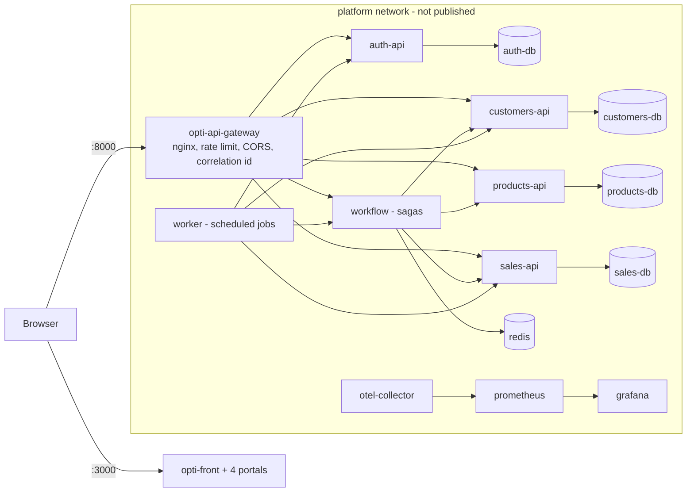

# 1 · Deployment model and "build once, deploy the artifact"

## 1.1 Where OptiView sits on the spectrum

| Model | What we manage | Does OptiView use it? | Evidence |
|---|---|---|---|
| IaaS (a VM) | VM + OS + Docker + everything | Yes, as the **single Docker host** of each environment | `opti-docs/05-architecture/deployment.md` §1: one Docker host per environment, no Kubernetes |
| Containers on a host / orchestrator | We ship images, the host runs them | Yes: Docker Compose is the orchestrator | `opti-infra/compose.yml` (`include:` of 16 `deploy/compose.yml`) |
| PaaS / managed containers | Push an image, the platform runs it | Prepared, not the main path | `opti-api-gateway` renders its routes from `*_API_URL` and `NGINX_RESOLVER` for "a host like Render" (`nginx/docker-entrypoint.d/15-render-routes.sh`, commit `a75bd5b`, SNI fix for `*.onrender.com`) |
| Serverless / FaaS | Functions only | No | Spring Boot services with state in PostgreSQL and Redis; not a fit |

Why this is the right point for us: one optical store per deployment (`01-context/scope.md`),
peak of ~8 sagas per hour (week 11, `05-slo.md`). A cluster would add operations work that the
load does not justify. What we lose is the rolling update that Kubernetes or a PaaS gives for
free; section 2 of `02-deployment-plan.md` covers that with a blue-green switch at the gateway.

## 1.2 Topology that is deployed

Only the gateway (`GATEWAY_PORT`, 8000) and the front (`FRONT_PORT`, 3000) publish ports. Each
domain has its own PostgreSQL instance and volume (ADR-003).

## 1.3 Health checks (needed by any zero-downtime strategy)

| Image | `HEALTHCHECK` | Endpoint |
|---|---|---|
| auth-api, customers-api, products-api, sales-api, worker, workflow | yes | `GET /health` on 8080 |
| api-gateway | yes | `GET /health` on 8000 |
| front and the 4 portals | yes | nginx |
| the 4 `-db` migration images | no (they are one-shot jobs, not services) | — |

Gap: the compose files do not use `depends_on: condition: service_healthy` between the APIs
and their databases (only `workflow → redis` and each `*-db-migrate` → its database do). The README of `opti-infra` accepts it: an
API answers `500` until its schema is migrated, and recovers on its own.

## 1.4 Do we "build once and deploy the artifact"?

**No, not yet.** This is the main finding of the week.

| 12-factor stage | What the guide asks | What OptiView does today |
|---|---|---|
| Build | Image built once, in CI | `publish.yml` builds in CI, but only on push to `develop`, and the compose files also have `build:` |
| Release | Same image + environment config | Each environment runs `up.sh`, which runs `docker compose up -d --build`: the image is **rebuilt from the local checkout** and tagged `opti/<service>:local` |
| Run | Run the release | Yes, with `.env` per environment (`env/.env.develop.example`, `.env.qa.example`, `.env.main.example`) |

Concrete problems found:

1. **Only `:latest`.** `publish.yml` in every repo pushes `ghcr.io/code-corhuila/<repo>:latest`.
   There is no `v3.0.0` or commit-SHA tag, so "the image that passed qa" cannot be named, and a
   rollback to "the previous image" has nothing to point at.
2. **Rebuild per environment.** `qa` and `main` would build their own images from whatever is
   checked out on that host. Two builds of the same commit can differ (base image updates,
   `npm ci` resolving a new transitive version).
3. **The last publish failed.** GitHub Actions, `Publish image` on `develop`, 2026-11-10 23:29–23:30
   UTC: `failure` in opti-api-gateway, opti-customers-api, opti-customers-portal, opti-front,
   opti-products-api, opti-products-portal, opti-sales-api, opti-sales-db and opti-sales-portal.
   The job finished in about one second with no runner and no steps (for example run
   `42923849949` of opti-customers-api), so the code was never built: Actions did not start the
   job. Consequence: GHCR `:latest` is still the October build, without the MVP 3 changes (OTP payments, private
   payment receipts, PDF invoice and prescription).

What changes in the plan: see `02-deployment-plan.md` §1 and `deploy/publish.yml`.
