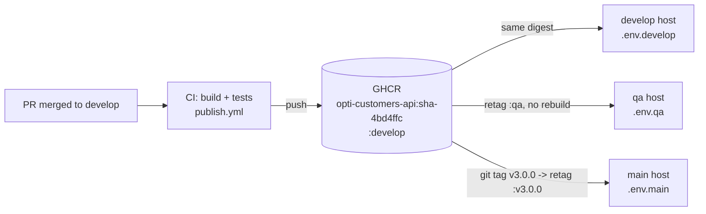

# 2 · MVP 3 deployment plan

Scope: the 16 deployable repositories composed by `opti-infra` (4 `-db`, 4 `-api`, gateway,
worker, workflow, front, 4 portals). Environments and branches already exist and are protected
in every code repo: `develop`, `qa`, `main` (GitHub API, `GET /repos/code-corhuila/<repo>/branches`,
`protected: true` for the three).

## 1. Artifact promotion: one image, three environments

Rules of the plan:

| # | Rule | How it is enforced |
|---|---|---|
| P1 | An image is built **once**, by CI, from a commit on `develop` | `deploy/publish.yml` (proposal): tags `sha-<7>` and `develop` |
| P2 | Promotion to `qa` / `main` is a **retag** of an existing digest, never a build | the same workflow on push to `qa`/`main` and on `v*` tags runs `docker buildx imagetools create` (copy of the manifest), not `docker build` |
| P3 | Hosts never build | `deploy/compose.release.yml` overrides every service with `image: ghcr.io/code-corhuila/<repo>:${OPTI_VERSION}` and the deploy runs `docker compose pull` + `up -d --no-build` |
| P4 | Only config changes between environments | `env/.env.develop.example`, `.env.qa.example`, `.env.main.example` already exist in `opti-infra`; `SEED_DEMO_DATA=false` outside develop |
| P5 | The release is the tag | `v3.0.0` on `main` of each repo; the image `:v3.0.0` is the same digest that ran in qa |

Version naming: `vMAJOR.MINOR.PATCH` (the team already uses `v2.0.0`, `v2.1.0`, `v3.0.0`).

## 2. Infrastructure as Code: what we have and where it drifts

### 2.1 Inventory

| Piece | Where | Declarative? |
|---|---|---|
| Composition of the platform | `opti-infra/compose.yml` (`include:` of the siblings) | yes |
| Each service: image, env vars, network, exposed port | `<repo>/deploy/compose.yml` | yes |
| Network `platform` | `opti-infra/scripts/up.sh` (`docker network create platform`) | script, idempotent |
| Config per environment | `opti-infra/env/.env.{develop,qa,main}.example` | yes (secrets as placeholders) |
| Database schema | `<domain>-db/01_ddl … 04_tcl` (Flyway, versioned) + `05_rollbacks/U*.sql` | yes |
| Gateway routing | `opti-api-gateway/nginx/routes-templates/*.conf.template` | yes |
| Observability | `opti-infra/observability/{otel-collector,prometheus,grafana-datasources}.y*ml` | yes |
| CI/CD | `.github/workflows/{ci,publish,db-ci}.yml` per repo | yes |

Recreating an environment is: clone the siblings, copy the `.env` example, fill the secrets,
`./scripts/up.sh`, run the four `*-db-migrate`. No step is a click in a console. This is the
part of the week that the team already had right.

### 2.2 Drift and snowflake risks found

| # | Risk | Evidence | Fix (story) |
|---|---|---|---|
| D1 | Hosts build their own images (see `01-deployment-model.md` §1.4) | `build:` + `image: opti/<svc>:local` in every `deploy/compose.yml` | DEP-01, DEP-03 |
| D2 | The "which commit runs where" is not recorded | `:local` tag, no label with the git SHA | DEP-01 (OCI labels `org.opencontainers.image.revision`) |
| D3 | `opti-infra` CI never fails on a bad compose file | `ci.yml` runs `docker compose config -q ... || true` | DEP-05 |
| D4 | Docs describe a platform we do not run | `10-devops/environments.md` talks about Kubernetes, canary 10 % and Vault; `05-architecture/deployment.md` still names `ms-pacientes`… and "4 schemas in one instance" while ADR-003 and the code use one instance per domain | DEP-06 |
| D5 | Images are pinned for third parties (`redis:7.4.9-alpine`, `prom/prometheus:v3.0.1`, `grafana/grafana:11.4.0`, `nginx:1.29.8-alpine`) but our own are not | compose files | DEP-01 |

## 3. Zero-downtime strategy

| Strategy | Fit for OptiView | Decision |
|---|---|---|
| Stop-then-start (`docker compose up -d` today) | Outage of ~20–40 s per API (JVM start + `HEALTHCHECK start-period=30s`) | rejected |
| Rolling | Needs ≥ 2 replicas and an orchestrator that replaces them one by one; Compose does not do it | not now |
| **Blue-green at the gateway** | Every user request enters through `opti-api-gateway`. Its routes are rendered from `*_API_URL` and resolved on every request; `nginx -s reload` swaps config gracefully (old workers finish their requests) | **chosen** for the stateless APIs |
| Canary | Possible later with nginx `split_clients`; with ~35 sagas a day a 10 % canary would get 3–4 orders | not useful at our traffic |

How the switch works (script `deploy/blue-green.sh`):

1. Start `customers-api-green` with the new image on the `platform` network
   (`deploy/compose.green.yml`), same DB and secrets as blue.
2. Wait until Docker reports it `healthy` (its own `HEALTHCHECK` on `/health`).
3. Smoke it directly from inside the network (`/health`).
4. Re-render the gateway route with `CUSTOMERS_API_URL=http://customers-api-green:8080` and run
   `nginx -t && nginx -s reload` inside the gateway container.
5. Verify through the gateway (`GET /api/v1/patients` with a dev token).
6. Keep blue running for instant rollback (switch back = step 4 with the blue URL).

Conditions that make this safe:

- **The APIs are stateless**: state is in each domain's PostgreSQL and in Redis (sagas), not in
  the JVM. Blue and green can share the database.
- **Expand/contract migrations**: a migration that runs before green must still work for blue
  (add column → deploy → backfill → drop old column in a later release). A destructive
  migration breaks the instant rollback.
- **Known gap:** internal callers (`opti-workflow`, `opti-worker`) call `http://customers-api:8080`
  directly, not through the gateway, so they keep using blue after the switch. For the user
  path that is fine; to move them too, give green the network alias `customers-api` and
  disconnect blue after the DNS caches expire (JVM ~30 s). The saga retries
  (`SAGA_MAX_ATTEMPTS=3`, `SAGA_RESUME_AFTER=PT30S`) absorb a failed call in that window.
  Story DEP-04.

## 4. Rollback

Two levels, both in `03-rollback-runbook.md`:

- **App** (seconds): switch the gateway back to blue; or redeploy the previous tag with
  `OPTI_VERSION=<previous> docker compose ... pull && up -d --no-build`.
- **Database** (minutes, only if a migration is the cause): run the `U*.sql` scripts of the
  version being undone. CI already proves these scripts on every PR to a `-db` repo
  (`db-ci.yml` → `scripts/verify-rebuild.sh`).

Target: **prod reverted in < 5 min**, measured by `deploy/rehearse-rollback.sh`
(see `deploy/HOW-TO-RUN.md`).
