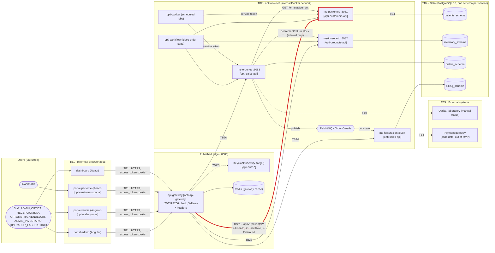

# CP1 — Attack surface and trust boundaries (OptiView)

Sources in opti-docs: `05-architecture/overview.md`, `05-architecture/deployment.md`,
`07-api/authentication.md`, `00-governance/security-policy.md`, `06-data/data-dictionary.md`.
Service names follow `overview.md` §4; the real repo is shown in brackets.

## 1. Data flow diagram (target architecture)

My boundary is **TB2b** (thick red edge): `api-gateway` → `ms-pacientes`.

Trust boundaries:

| ID | Boundary | Why the trust level changes |
|---|---|---|
| TB1 | Browser apps → `api-gateway` | Internet traffic reaches the only published port (:8080) |
| **TB2b** | **`api-gateway` → `ms-pacientes`** | **The gateway's verdict (identity headers) is trusted by the service** |
| TB2a/c/d | `api-gateway` → other domain services | Same pattern, other domains |
| TB3 | Service ↔ service and `ms-ordenes` → RabbitMQ → `ms-facturacion` | Internal calls and events inside `optiview-net` |
| TB4 | Service → its PostgreSQL schema | Code → persistent PII |
| TB5 | OptiView → laboratory / payment gateway | Leaves our control |

## 2. Asset inventory (patients domain)

| # | Asset | Where it lives | Classification |
|---|---|---|---|
| A1 | Patient identity and contact data: `document_type`, `document_number`, names, `birth_date`, `phone`, `email`, `address` | `patients_schema.patients` | restricted |
| A2 | Optical formulas: `sphere_od/oi`, `cylinder_od/oi`, `axis_od/oi`, `addition_od/oi`, `pupillary_distance` | `patients_schema.optical_formulas` | restricted |
| A3 | Periodic controls (`next_control_date`, `status`) | `patients_schema.periodic_controls` | confidential |
| A4 | Identity headers `X-User-Id`, `X-User-Role`, `X-Patient-Id` | In transit gateway → `ms-pacientes` | confidential |
| A5 | JWT access token (RS256, 1 h) and refresh token (7 days) | `access_token` httpOnly cookie, gateway | restricted |
| A6 | JWT signing key pair | Keycloak target; today `opti-infra/keys/` | restricted |
| A7 | `X-Correlation-Id` and audit/security logs (`DATA_PII_ACCESSED`) | Logs, observability stack | internal |
| A8 | Patients OpenAPI contract | `07-api/contracts/openapi/` | public |

## 3. Entry points of my boundary (TB2b)

`api-gateway` publishes `/api/v1/patients/**` and strips `/api/v1`, so `ms-pacientes` sees `/patients/**`.

| Entry point (gateway path) | Permission | Who calls it | How it authenticates today |
|---|---|---|---|
| `GET /api/v1/patients` | `patients:read` | Staff roles, `PACIENTE` (own record only) | Gateway validates JWT (401); service checks `X-User-Role` (403) and forces `X-Patient-Id` filter for `PACIENTE` |
| `POST /api/v1/patients` | `patients:create` | `RECEPCIONISTA`, `OPTOMETRA`, `ADMIN_OPTICA` | JWT at gateway + role in use case |
| `GET /api/v1/patients/{id}` | `patients:read` | Staff, `PACIENTE` (*own*) | JWT + role + ownership (`X-Patient-Id` = `{id}`) |
| `GET /api/v1/patients/{id}/formulas` | `formulas:read` | `OPTOMETRA`, staff, `PACIENTE` (*own*) | JWT + role + ownership |
| `POST /api/v1/patients/{id}/formulas` | `formulas:create` | `OPTOMETRA` | JWT + role |
| `GET /api/v1/patients/{id}/formulas/current` | `formulas:read` | Staff, `PACIENTE` (*own*); also `ms-ordenes` directly | JWT + role; internal call with Bearer or service token |
| `GET /api/v1/patients/overdue-controls` | `patients:read` | Staff only; `opti-worker` | JWT + role, `PACIENTE` gets 403 |
| Port `:8081` inside `optiview-net` | — | Any container on the network | **Nothing but network isolation**: the service trusts `X-User-*` headers |

Key observation: `07-api/authentication.md` says the gateway validates the JWT and the
service trusts `X-User-*` headers. The code does something else: `customers.conf.template`
in `opti-api-gateway` only checks that a credential is present (401 otherwise) and passes the
`Authorization` header through, and `opti-customers-api` verifies the RS256 token itself in
`Rs256Verifier` (signature, `exp`, `sub`, but not `iss` or `aud`). `PatientController` checks
roles only on the write endpoints; `GET /{id}`, `GET /{id}/formulas` and
`GET /{id}/formulas/current` accept any valid token. This gap is the starting point of CP2.
