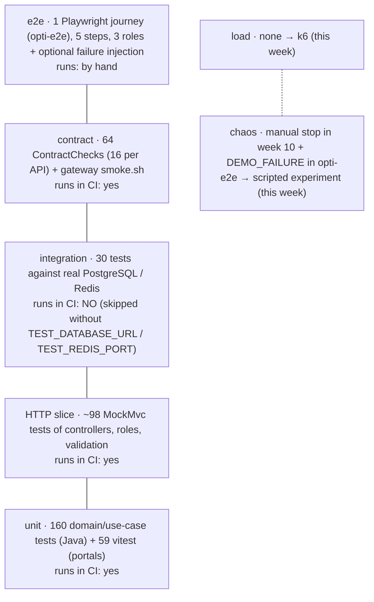

# 1 · OptiView's test suite against the distributed testing pyramid

Counted on 2026-11-12 from the `develop` clones (`@Test`/`@ParameterizedTest` in Java, `it(`/`test(`
in `*.test.*` for the portals). "Runs in CI" means it is executed by today's `ci.yml`
(ignoring that Actions itself is down since 2026-11-06, see week 14).

## 1.1 Inventory

| Layer | Where | Count | Runs in CI | Comment |
|---|---|---|---|---|
| Unit (domain + use cases) | `*-core/src/test` | auth 23 · customers 15 · products 59 · sales 32 · worker 11 · workflow 20 = **160** | yes | in-memory adapters (`InMemory*Repository`, `TestClock`, `SequentialIds`): fast and deterministic |
| Unit (portals) | `src/**/*.test.ts(x)` | front 7 · auth 9 · customers 13 · products 15 · sales 15 = **59** | yes | vitest |
| HTTP slice | `*-app/src/test` (`*HttpTest`) | **~98** (162 in `*-app` minus the 64 contract checks) | yes | real controllers + security filter, fake adapters |
| Contract (common contract, Annex C) | `ContractChecks` base class, extended per resource | **64** (16 per API) | yes | 401 without token, error envelope + `traceId`, correlation id, validation at the border, idempotent `POST` with `Idempotency-Key`, bounded listings |
| Contract (gateway) | `opti-api-gateway/tests/smoke.sh` | 1 script, 14 checks | yes | real nginx, upstreams down → 503 |
| Integration, real DB | `Jdbc*IntegrationTest` in the 4 APIs | auth 5 · customers 8 · products 6 · sales 7 = **26** | **no** | need `TEST_DATABASE_URL` |
| Integration, real Redis | `RedisSagaStoreIntegrationTest` (workflow) | **4** | **no** | needs `TEST_REDIS_PORT` |
| Integration, DB schema | `db-ci.yml` → `verify-rebuild.sh` (4 `-db` repos) | 4 pipelines | yes | migrate, re-migrate = 0, undo all, migrate |
| End to end | `opti-e2e/tests/demo.spec.ts` (Playwright) | 1 journey: ADMIN registers a frame → OPTOMETRIST patient + formula → SELLER sale by saga, approve, payments, delivery → ADMIN dashboard | by hand | covers the **money path**; `DEMO_FAILURE=1` stops sales-api and checks the other pages still work |
| Load | — | **0** | — | added in `02-load-test.md` |
| Chaos | week 10 manual test, `DEMO_FAILURE` | informal | — | formalised in `03-chaos.md` |

## 1.2 Reading

- The base of the pyramid is healthy: ~320 fast tests, hexagonal design makes the use cases
  testable without Spring.
- The middle has a hole exactly where the guide warns: **"mocks lie about the database"**. The
  30 tests that would catch a wrong SQL, a missing grant or a migration mismatch exist but are
  skipped in CI. Week 14 `pipeline/ci-api.yml` (job `integration`) turns them on with a Postgres
  service migrated by Flyway from the `-db` repo — the same idea as Testcontainers, without
  adding the dependency. Testcontainers is still the better long-term option because the test
  owns its container and runs the same on a laptop (story TST-01).
- Contract: we protect the **common** contract well, but not each service's schema. A
  consumer-driven check would protect the most fragile boundary: `opti-workflow` (consumer) →
  `POST /api/v1/frames/{id}/reservations` (products) and `POST /api/v1/work-orders` (sales). Story TST-02.
- E2E: one journey, the right one (the money path). It is not in any pipeline; `release-smoke.yml`
  (week 14) is the light version that can run in CI.

## 1.3 Stories

| ID | Story | Acceptance criterion |
|---|---|---|
| TST-01 | Integration tests run in CI against real PostgreSQL and Redis | The CI report shows 26 + 4 integration tests executed, 0 skipped (week 14 `ci-api.yml`) |
| TST-02 | Consumer contract of the saga participants | A change in the response of `reserve`/`open-order` that drops a field `opti-workflow` reads fails the provider's CI |
| TST-03 | Load test to the SLO (`02-load-test.md`) | k6 thresholds green at 2 sagas/s + 20 reads/s; knee documented |
| TST-04 | Chaos experiment on the saga (`03-chaos.md`) | H1–H3 verified; any deviation becomes an issue |
| TST-05 | `opti-e2e` runs in `release-smoke` before `main` | the Playwright journey is green on the release candidate |
