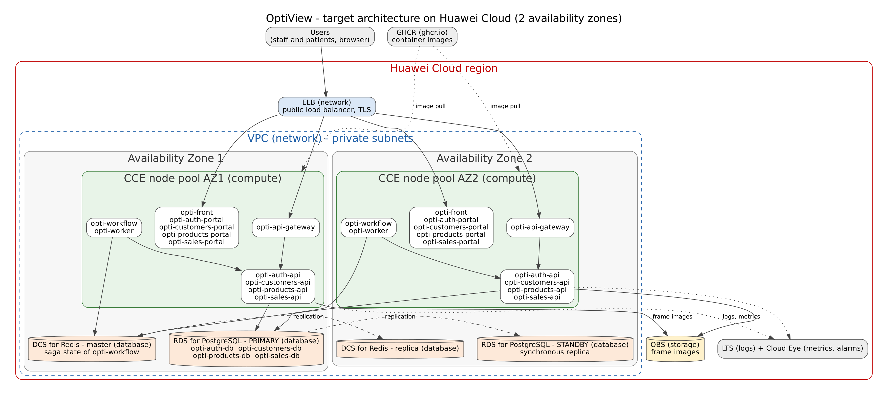

# Architecture design note — OptiView

## 1. Target architecture

**Current architecture**

OptiView is a distributed application designed to manage the daily operations of an optical store. Its main functions include authentication, patient information, optical prescriptions, inventory management, work orders, invoices, and payments.

The system follows a microservices architecture with four independent business domains: authentication, customers, products, and sales. Each domain has its own API and PostgreSQL database. This separation helps preserve data ownership and prevents direct database access between services.

The platform also includes an NGINX API gateway, a workflow orchestrator, and a background worker. The gateway routes requests to the corresponding APIs. The workflow coordinates business operations across multiple domains using the Saga pattern, while Redis stores saga execution states. The worker performs scheduled tasks, such as expiring old quotations and identifying overdue patient controls.

The frontend is built with React and Module Federation, allowing different business portals to operate within a shared application.

**Proposed cloud architecture**

For the target architecture, I would evaluate Huawei Cloud Container Engine (CCE) to host the application containers. The deployment would use at least two availability zones to reduce dependency on a single infrastructure location.

Elastic Load Balance (ELB) would distribute incoming requests, and Virtual Private Cloud (VPC) would provide network isolation between public and internal components.

I would preserve the four independent PostgreSQL databases using Relational Database Service (RDS). This would maintain the existing separation between business domains while providing managed database operations.

Distributed Cache Service (DCS) for Redis would store saga execution states outside the workflow containers. This is important because the orchestrator must recover unfinished operations after a restart.

Object Storage Service (OBS) could replace the existing shared volume used for product images, provided that the products API and gateway are adapted to support object storage.

The proposed architecture aims to improve availability, support horizontal scaling, and maintain the existing business responsibilities without combining the services into a monolithic application.

**Component mapping**

| Component in the diagram | Proposed Huawei Cloud service | Defined in (opti-docs) |
|---|---|---|
| opti-front | CCE, ELB | 05-architecture/overview.md |
| opti-auth-portal | CCE | 05-architecture/overview.md |
| opti-customers-portal | CCE | 05-architecture/overview.md |
| opti-products-portal | CCE | 05-architecture/overview.md |
| opti-sales-portal | CCE | 05-architecture/overview.md |
| opti-api-gateway | CCE, ELB | 05-architecture/overview.md |
| opti-auth-api | CCE | 05-architecture/overview.md |
| opti-customers-api | CCE | 05-architecture/overview.md |
| opti-products-api | CCE | 05-architecture/overview.md |
| opti-sales-api | CCE | 05-architecture/overview.md |
| opti-workflow | CCE, DCS | 05-architecture/decisions/records/ADR-004-place-order-saga.md |
| opti-worker | CCE | 05-architecture/decisions/records/ADR-005-outbox-eventual-consistency.md |
| opti-auth-db | RDS for PostgreSQL | 05-architecture/decisions/records/ADR-003-database-per-service.md |
| opti-customers-db | RDS for PostgreSQL | 05-architecture/decisions/records/ADR-003-database-per-service.md |
| opti-products-db | RDS for PostgreSQL | 05-architecture/decisions/records/ADR-003-database-per-service.md |
| opti-sales-db | RDS for PostgreSQL | 05-architecture/decisions/records/ADR-003-database-per-service.md |
| Redis saga state | DCS for Redis | 05-architecture/decisions/records/ADR-004-place-order-saga.md |
| Frame images | OBS | 04-requirements/user-stories.md |

## 2. Five principles

The proposed architecture considers five principles: reliability, security, performance efficiency, cost, and operations. These principles help evaluate the current system and identify improvements for a potential deployment on Huawei Cloud.

| Principle | Current weakness | Evidence in -docs | Design decision | Huawei Cloud service |
|---|---|---|---|---|
| Reliability | Every environment, production included, runs one replica per service on Docker Compose, with no second availability zone. | 05-architecture/deployment.md | Distribute application replicas across two availability zones and use managed database redundancy. | CCE, ELB, RDS |
| Security | Secrets live in `.env` files, and the secrets store for staging and production is still a pending team decision. | 05-architecture/deployment.md | Centralize secret management, restrict internal connectivity, and preserve service-level JWT validation. | DEW, IAM, VPC |
| Performance efficiency | No autoscaling has been decided, so a traffic peak is served by the same single replica. | 05-architecture/deployment.md | Introduce horizontal autoscaling for selected APIs using monitored resource metrics. | CCE, Cloud Eye |
| Cost | The documentation itself notes that running every service, gateway and event bus adds operational cost that is not proportional to the scope. | 05-architecture/overview.md | Set reasonable minimum and maximum replica counts and review resource consumption. | CCE, Cloud Eye |
| Operations | Observability (structured logs, metrics and tracing) is still pending as technical debt AT-002, and rollback is a manual redeploy. | 05-architecture/overview.md | Introduce centralized logs, monitoring, controlled QA and production deployments, and rollback procedures. | CCE, LTS, Cloud Eye |

**Reliability and security**

Reliability is particularly important for the sales and products domains because interruptions could affect stock reservations, invoices, and work orders. Running multiple replicas would reduce dependency on individual application instances, although database availability and cross-service consistency would still require separate protection.

Security must be maintained at different levels. The gateway already performs preliminary request filtering, while individual services validate JWT signatures, expiration, and permissions. I would preserve this model and strengthen infrastructure security through private networks, restricted permissions, and controlled secret storage.

**Performance, cost, and operations**

Performance efficiency should be based on observed workloads rather than scaling every service equally. The products and sales APIs are reasonable candidates because they process inventory and transaction requests.

Cost management requires balancing availability against resource consumption. Each service should receive resource limits appropriate to its workload instead of using the same configuration everywhere.

For operations, centralized logs and monitoring would help identify service failures. Correlation identifiers already used by OptiView could connect requests across the gateway, domain services, and workflow, improving incident investigation.

## 3. Scalability

I would prioritize horizontal scaling for `opti-products-api` and `opti-sales-api` because both participate in important business operations.

| Service | Scaling metric | Threshold | Minimum instances | Maximum instances |
|---|---|---|---|---|
| opti-products-api | Average CPU utilization | 70% for 5 minutes | 2 | 6 |
| opti-sales-api | Average CPU utilization | 65% for 5 minutes | 2 | 6 |

**Products API**

The products API manages optical frames, inventory movements, and stock reservations. During busy periods, the number of requests could increase as employees search products or reserve items for orders.

I would configure horizontal scaling through Kubernetes Horizontal Pod Autoscaler in CCE. A minimum of two replicas would support application availability, while a maximum of six would limit resource consumption.

However, replicas must not independently modify inventory without database coordination. The existing idempotency mechanisms and transactional controls should remain active to prevent duplicate reservations.

**Sales API**

The sales API processes work orders, invoices, and payments. These operations require particular attention because a repeated request must not create duplicated financial records.

I would start with two replicas and allow expansion to six when CPU utilization remains above the proposed threshold.

The service already uses idempotency keys and PostgreSQL transactions. These mechanisms should be preserved when multiple replicas handle requests concurrently.

Both scaling policies are initial design targets. Load tests would be necessary to validate the thresholds and determine whether CPU utilization is an appropriate predictor of application demand.

## 4. Disaster recovery

The most critical data store selected for this proposal is `opti-sales-db`, which contains information related to work orders, invoices, and payments.

Losing this information could affect financial records and make it difficult to determine which orders and payments were completed.

| Recovery parameter | Proposed objective |
|---|---|
| Critical data store | opti-sales-db |
| Database engine | PostgreSQL |
| Cloud service | Huawei Cloud RDS |
| Recovery Time Objective (RTO) | 30 minutes |
| Recovery Point Objective (RPO) | 5 minutes |
| Recovery pattern | Primary-standby database across availability zones |

I would evaluate the primary-standby disaster recovery pattern discussed in Chapter 11 of the Huawei course.

The primary database would process normal application transactions, while a standby instance in another availability zone would provide a recovery target if the primary database became unavailable.

The proposed RTO of 30 minutes means that the database service should be restored within that period after a qualifying failure. The proposed RPO of 5 minutes means that the accepted loss of committed data would not exceed five minutes.

This pattern meets those numbers because the primary replicates every committed transaction synchronously to the standby in the second availability zone and RDS fails over automatically in a few minutes, so a zone failure loses almost no committed data and the database is back well within 30 minutes. For logical failures, such as an accidental deletion, the automated full backups plus the incremental log backups that RDS takes every five minutes allow a point-in-time restore that loses at most five minutes of data, which a daily backup alone could never achieve.

To support these objectives, the implementation would need monitored replication, a tested failover procedure, appropriate backup retention, and periodic recovery exercises.

Database recovery also does not automatically restore consistency across the entire distributed workflow.

OptiView uses sagas to coordinate patient validation, inventory reservations, and order creation. Therefore, recovery procedures should also account for Redis saga state and idempotent compensation operations.

This approach would combine database recovery with the distributed transaction mechanisms already present in the system.

## 5. Automated deployment

OptiView already uses GitHub Actions for continuous integration and container image publication.

For example, the sales API workflow executes Maven verification for pull requests, while its publication workflow builds a Docker image and uploads it to GitHub Container Registry.

I would extend these existing capabilities into a controlled deployment process for Huawei Cloud CCE.

| Stage | Trigger | Tool or service | File in your team's repositories |
|---|---|---|---|
| Build | Pull request to a maintained branch | GitHub Actions, Maven | opti-sales-api/.github/workflows/ci.yml |
| Test | Pull request | Maven verify | opti-workflow/.github/workflows/ci.yml |
| Image | Push to develop | Docker Buildx, GHCR | opti-sales-api/.github/workflows/publish.yml |
| Deploy to qa | Merge to the qa branch (proposed) | GitHub Actions, CCE | opti-infra/compose.yml |
| Deploy to production | Approved release merged to main (proposed) | GitHub Actions, CCE | opti-docs/10-devops/environments.md |
| Rollback | Failed release or failed health checks | Previous image tag, Kubernetes rollout undo | opti-docs/05-architecture/deployment.md |

**Continuous integration**

The build and test stages would run before deploying changes. Maven verification would help detect regressions in business rules, API behavior, and persistence operations.

**Container images**

After successful validation, the pipeline would build Docker images and publish them to GHCR.

For reproducible deployments, I would use immutable image identifiers rather than relying exclusively on the `latest` tag.

**Deployment to QA**

Today, `opti-infra/compose.yml` assembles the whole platform for an environment. The QA environment would run the proposed architecture in CCE with isolated application configuration and test data. Deployment would occur only after the required checks and approvals.

**Production deployment**

The environments and their access rules are described in `opti-docs/10-devops/environments.md`. Production releases would use controlled promotion and rolling updates, allowing new application instances to become healthy before older instances are removed.

**Rollback**

The current rollback procedure, documented in `opti-docs/05-architecture/deployment.md`, redeploys the previous image tag. In CCE, the same idea would become a rollout back to the previous known-good image.

Database migrations would require additional precautions. For example, the sales database documentation establishes that migration V020 must precede the corresponding API and gateway changes.

Reverting an application image would not automatically justify reversing a database migration, especially when doing so could destroy records.

The QA deployment, production deployment, and automated rollback workflows are proposed improvements rather than capabilities already confirmed in the existing GitHub Actions workflows.

## 6. Decisions

- [ADR-C3-01](ADR-C3-01.md): Deploy OptiView microservices on Huawei Cloud CCE with multi-availability-zone application replicas.
- [ADR-C3-02](ADR-C3-02.md): Protect OptiView sales data through a managed PostgreSQL primary-standby architecture across availability zones.
